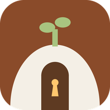
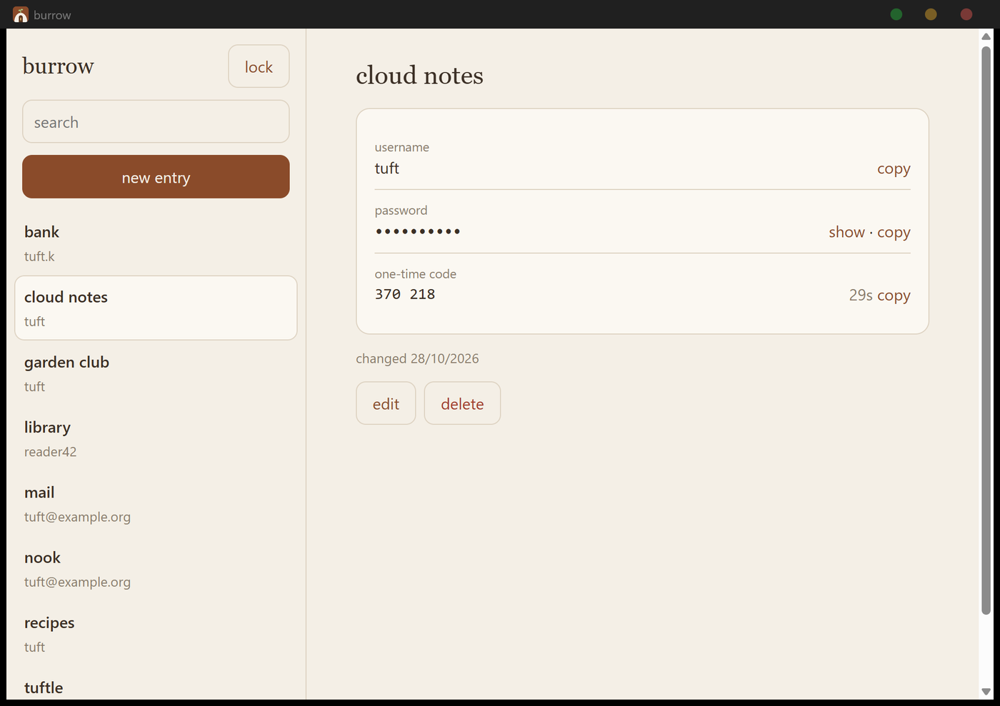
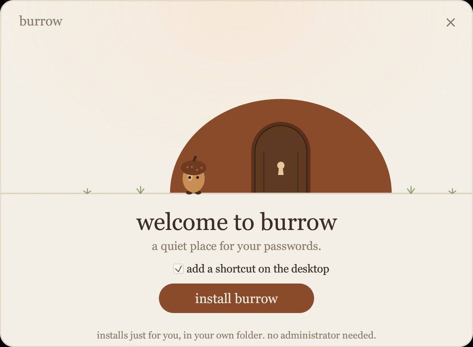
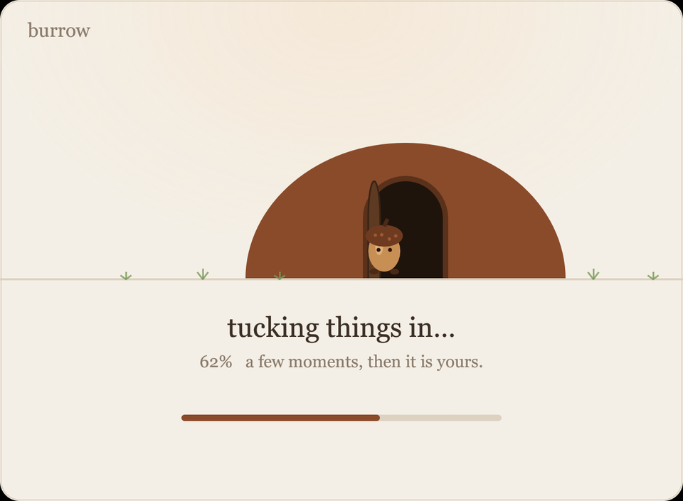
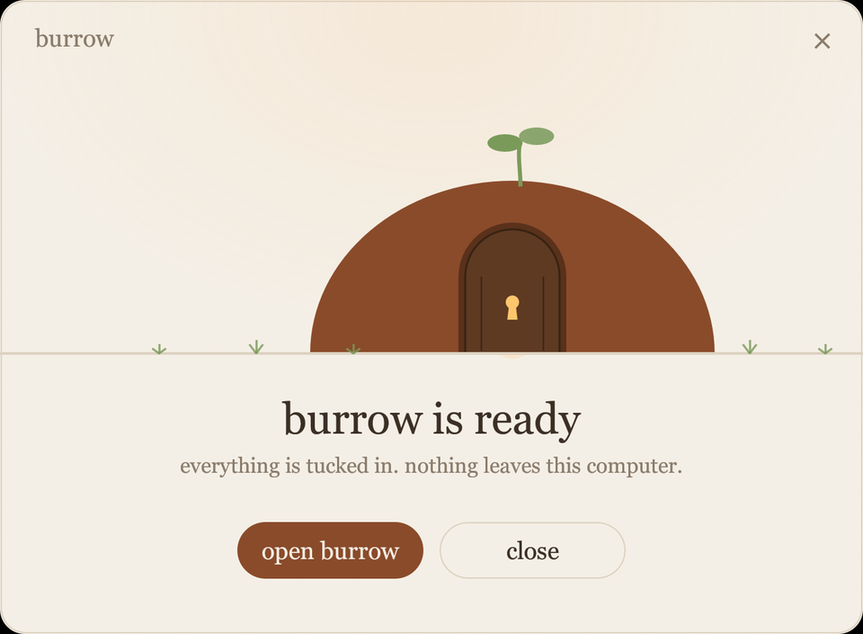
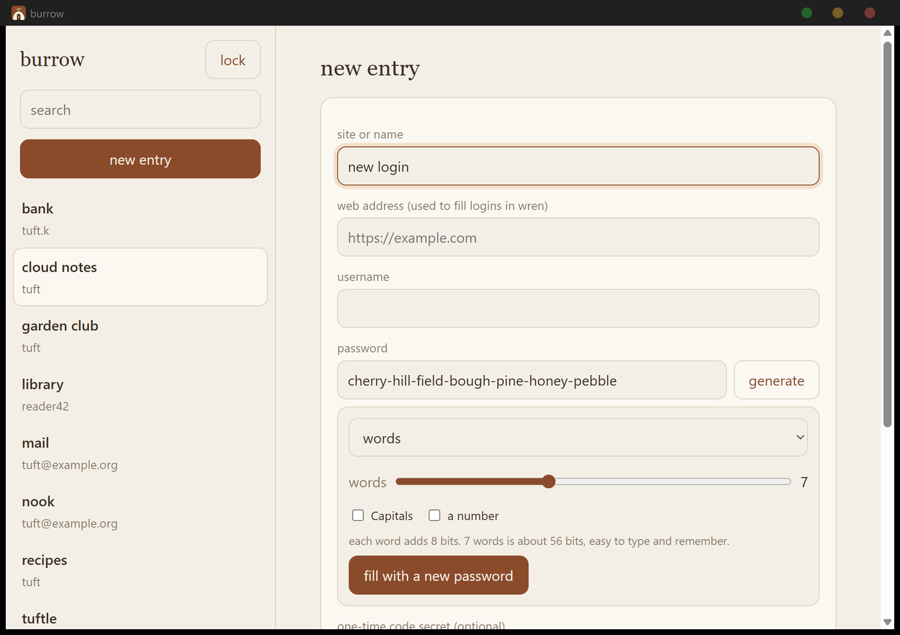

<div align="center">



# Burrow

A password manager with a calm interface, one encrypted file and no accounts.

[](LICENSE)
[](#install)
[](docs/THREAT-MODEL.md)
[](https://github.com/Tuftle/burrow/releases/latest)

[Website](https://tuftle.vercel.app/burrow) &ensp;◆&ensp; [Download](https://github.com/Tuftle/burrow/releases/latest) &ensp;◆&ensp; [Threat model](docs/THREAT-MODEL.md) &ensp;◆&ensp; [Building](#building)

</div>

<br>



<br>

## ◆ Overview

Burrow keeps your logins in a single file that only your master password can open. Everything is encrypted on your own
computer, so there is no server to trust and nothing to sign up for. It runs on the web, as a Windows app, as a portable
exe, and built into [Wren](https://github.com/Tuftle/wren), all from the same code and the same vault format.

| | |
| :-- | :-- |
| **Interface** | The tuftle palette: warm cream and brown, serif type, lowercase wording. Light and dark follow the system. |
| **Vault** | One encrypted file. Argon2id turns the master password into a key, AES-256-GCM protects the contents. |
| **Privacy** | No account, no sync service, no telemetry. The only network call is a breach check that you start yourself. |
| **Recovery** | A recovery key is shown once, when the vault is made. There is no reset and no back door. |
| **Import** | Logins from Chrome, Edge and Firefox (CSV) and Bitwarden (JSON). |

---

## ◆ Install

**Windows 10 and 11, 64-bit.**

1. Download `Burrow-Setup.exe` from the [latest release](https://github.com/Tuftle/burrow/releases/latest).
2. Run it. It installs for the current user into `%LOCALAPPDATA%\Programs\Burrow`, so no administrator rights are needed,
   and adds a Start menu shortcut.
3. Make a vault. Burrow shows a recovery key once, and asks you to confirm that you have saved it.

Prefer a single file? `Burrow-Portable.exe` is the same app. Its vault and settings live in a `burrow-data` folder next to
it, and it writes nothing anywhere else, so it can sit on a USB stick.

<table>
<tr>
<td width="33%"></td>
<td width="33%"></td>
<td width="33%"></td>
</tr>
<tr>
<td align="center"><sub>Welcome</sub></td>
<td align="center"><sub>An acorn finds its burrow</sub></td>
<td align="center"><sub>Ready</sub></td>
</tr>
</table>

> The installer is not code-signed yet, so Windows SmartScreen may warn on first run. The SHA-256 of each release file
> is listed in the release notes.

To remove Burrow, use Windows Settings, then Apps, or run `%LOCALAPPDATA%\Programs\Burrow\uninstall\Burrow-Uninstall.exe`.
Your vault file is kept unless you choose to delete it.

**In Wren**, Burrow is already built in. Press `Alt+Shift+V` to open it.

---

## ◆ What is in it

<table>
<tr>
<td width="50%" valign="top">

**Vault**

- ✦ Encrypted with Argon2id (64 MiB) and AES-256-GCM
- ✦ A changed or damaged file is refused, never half opened
- ✦ Recovery key, and a new master password without re-encrypting entries
- ✦ Locks after five quiet minutes, or at once with `Ctrl+L`
- ✦ Copied passwords are cleared after 20 seconds
- ✦ Encrypted backup and restore

</td>
<td width="50%" valign="top">

**Passwords**

- ✦ Random characters, or a passphrase of plain words
- ✦ Seven words is about 56 bits and easy to remember
- ✦ One-time codes with a countdown
- ✦ Notes and a web address for every login
- ✦ Search from anywhere with `Ctrl+K`
- ✦ Strength hint while you choose a master password

</td>
</tr>
<tr>
<td width="50%" valign="top">

**Checkup**

- ✦ Lists weak passwords and passwords used twice
- ✦ Runs on your computer and shows nothing to anyone
- ✦ Optional breach check, started by you
- ✦ Import from Chrome, Edge, Firefox and Bitwarden
- ✦ Export an encrypted backup, or a plain CSV behind a warning
- ✦ Imports skip logins you already have

</td>
<td width="50%" valign="top">

**In Wren**

- ✦ A small chip offers the login for the page you are on
- ✦ It only appears for that exact site, over https
- ✦ Nothing is filled until you click it
- ✦ "Save this login?" after you sign in somewhere new
- ✦ `Alt+Shift+V` opens Burrow, `Alt+Shift+L` fills the page
- ✦ The panic key closes Wren and drops every open login

</td>
</tr>
</table>

<br>



---

## ◆ How it protects you

Burrow stretches your master password with Argon2id into a key. That key unwraps a random data key, and the data key
encrypts the vault. The recovery key unwraps a second copy of the same data key, so changing the master password only
rewraps one key.

What it protects against, and what it does not, is written down in the [threat model](docs/THREAT-MODEL.md). The short
version: a stolen vault file is only as strong as your master password, and no password manager can help on a computer
that already has malware running as you.

---

## ◆ Privacy

Burrow sends no telemetry, has no accounts and does not check for updates by itself yet. One feature can contact a server,
and only when you press its button.

| What | When | What is sent |
| :-- | :-- | :-- |
| **Breach check** | Only when you press **check for breaches** and confirm | The first five characters of a SHA-1 fingerprint of each password, to `api.pwnedpasswords.com`. Never a password, and never a site name. |

The vault, the recovery key and your master password never leave the device. The web app keeps the vault in the browser's
own storage, the Windows app in `%APPDATA%\Burrow\vault.json`, and the portable exe in its `burrow-data` folder.

---

## ◆ Repository layout

```
burrow/
├── web/            the app: plain HTML and JavaScript, no framework
│   ├── crypto.js       vault encryption, keys, recovery
│   ├── generator.js    passwords and passphrases (words.js is the word list)
│   ├── importers.js    Chrome, Edge, Firefox and Bitwarden files, CSV export
│   ├── totp.js         one-time codes
│   ├── health.js       weak, reused and breached passwords
│   ├── match.js        which logins belong to which page
│   ├── store.js        where the vault is kept (browser or file)
│   └── vendor/         Argon2id (hash-wasm, WebAssembly)
├── desktop/        Tauri shell for Windows that embeds web/
├── installer/      Burrow-Setup.exe, an egui window, no NSIS
├── tests/          38 tests, run with node
├── tools/          logo drawing, copying web/ into Wren
└── docs/           threat model, Wren notes, screenshots
```

---

## ◆ Building

You need Node 20 or newer. For the Windows files you also need Rust and the Visual Studio build tools.

```
npm install
npm test
```

Run the web app on its own:

```
cd web
python -m http.server 8731
```

Build the Windows app, the installer and the portable exe:

```
cd desktop   && cargo build --release --features custom-protocol
cd ../installer && cargo build --release && python make.py
```

`make.py` writes `Burrow-Setup.exe`, `Burrow-Portable.exe` and `SHA256SUMS.txt` to the folder you give it. The installer
carries `burrow.exe` on its end. Every installer screen can be previewed with `burrow-setup.exe --preview-installing=0.5`,
`--preview-done` or `--preview-removed`, with `--light` or `--dark`.

How the Wren side works is in [docs/WREN.md](docs/WREN.md).

---

## ◆ Not done yet

- Sync between computers. It is planned as an optional encrypted blob on a private store, with no accounts. For now, copy
  the encrypted backup, or keep the vault file in a folder you already sync yourself.
- Code signing, so SmartScreen will stop warning.
- macOS and Linux builds.
- Update checks inside the Windows app.

---

## ◆ Related

| | |
| :-- | :-- |
| **[wren](https://github.com/Tuftle/wren)** | The browser that has Burrow built in. |
| **[nook](https://github.com/Tuftle/nook)** | The search engine Wren uses by default. |
| **[tuftle](https://github.com/Tuftle/tuftle)** | The website, with the Burrow page. |

---

## ◆ Licence

Burrow is released under the [Mozilla Public License 2.0](LICENSE), the same licence as Wren. The Argon2id build in
`web/vendor` is [hash-wasm](https://github.com/Daninet/hash-wasm), which is MIT licensed.

<div align="center">

<br>

◆ &ensp; ◆ &ensp; ◆

<sub>Made by <a href="https://github.com/Tuftle">tuftle</a></sub>

</div>
